<div align="center">
  <a href="https://v2.nonebot.dev/store"></a>
  <br>
  <p></p>
</div>

<div align="center">

# nonebot-plugin-disconnect-notice

_✨ bot断连时的通知插件，支持多种通知方式 ✨_


<a href="./LICENSE">
    
</a>
<a href="https://pypi.python.org/pypi/nonebot-plugin-disconnect-notice">
    
</a>


</div>

## 📖 介绍

- 可以在bot断开与nonebot的连接时向主人发送微信公众号消息或邮件消息，用来通知主人bot可能被风控掉线
- 目前支持全部适配器协议，通知方式支持:
    - [pushplus](https://www.pushplus.plus/)微信公众号通知;
    - [server酱Turbo](https://sct.ftqq.com/r/1483)(方糖)微信公众号通知;
    - [server酱3](https://sc3.ft07.com/)安卓/ios app离线通知;
    - [pushover](https://pushover.net/)安卓/ios/ipad/pc多设备通知; emil邮件通知;
    - 飞书 群聊bot通过webhook模式通知;
    - emil邮件通知;
- 如果有其他通知方式的需求，欢迎提issues或pr

## 💿 安装

<details>
<summary>使用 nb-cli 安装</summary>
在 nonebot2 项目的根目录下打开命令行, 输入以下指令即可安装

    nb plugin install nonebot-plugin-disconnect-notice

</details>


<details>
<summary>使用包管理器安装</summary>
在 nonebot2 项目的插件目录下, 打开命令行, 根据你使用的包管理器, 输入相应的安装命令
<details>
<summary>pdm</summary>

    pdm add nonebot-plugin-disconnect-notice

</details>

<details>
<summary>poetry</summary>

    poetry add nonebot-plugin-disconnect-notice

</details>

</details>

## ⚙️ 配置

运行插件前，需要在 nonebot2 项目的`.env.prod`文件中按照不同推送方式添加下表中的相应配置项

<details>
<summary>server酱Turbo(方糖)公众号消息配置教程</summary>

> server酱Turbo每天免费消息推送额度只有5条

> server酱Turbo和server酱3的区别:Turbo是微信公众号推送，3是app推送

1. 进入[server酱Turbo官网](https://sct.ftqq.com/r/1483)
2. 点击网页右上角 **登录** 按钮，微信扫码完成登录
3. 回到网页端点击 **扫码后点此继续**  按钮
4. 点击sendkey下方的 **复制** 按钮，或者你可以新建单独的appkey，然后进行复制

   
5. 将token按照下方配置项名 disconnect_notice_server_key = "" 填入`.env.prod` 文件内

</details>

<details>
<summary>server酱3 消息配置教程</summary>

> server酱3现在内测期间可以免费使用

> server酱Turbo和server酱3的区别:Turbo是微信公众号推送，3是app推送

1. 进入[server酱3官网](https://sc3.ft07.com/)
2. 点击网页右上角 **登入** 按钮，微信扫码完成登录
3. 回到网页端点击 **手机扫码后点此以登入**  按钮
4. 点击sendkey旁边的 **复制** 图标
    - 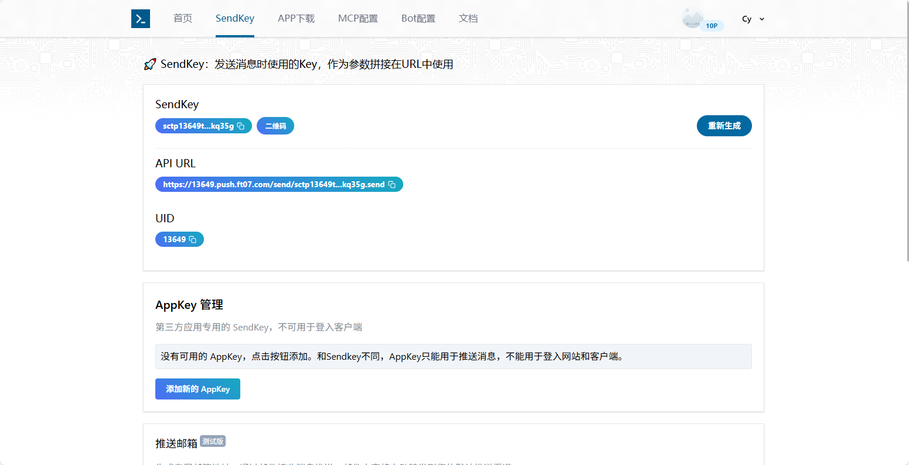
5. 将token按照下方配置项名 disconnect_notice_server3_key = "" 填入`.env.prod` 文件内
6. 访问[app下载页面](https://sc3.ft07.com/client)从支持机型的应用商店下载，或直接下载apk
    - 你也可以通过手机扫描下面二维码进入下载页面
    - 
7. app端复制刚刚的sendkey，或扫码sendkey旁边二维码完成填写
8. 后续app就能收到推送消息，下列品牌手机(iOS/FCM/小米/华为/荣耀/vivo/oppo/iQOO/Realme/OnePlus/魅族)
   ，即便应用不在后台，也能通过厂商通道收到推送消息
    - 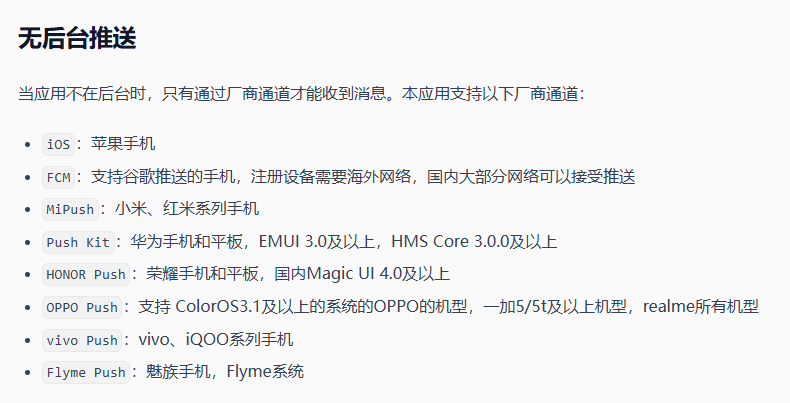

</details>

<details>
<summary>pushplus微信公众号消息配置教程</summary>

> pushplus现在强制要求实名以及每次实名1元认证费用，推荐使用其他推送配置

1. 进入[pushplus官网](https://www.pushplus.plus/)
2. 点击网页右上角 **登录** 按钮，微信扫码完成登录
3. 点击公众号提示的该卡片完成登录绑定，提示启用成功即可

   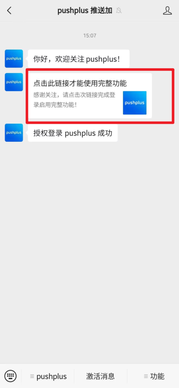
4. 回到网页端，顶部菜单栏选择**发送消息 - 一对一消息**,然后点击**一键复制**

   
5. 将token按照下方配置项名 disconnect_notice_pushplus_token = "" 填入`.env.prod` 文件内

</details>

<details>
<summary>pushover消息配置教程</summary>

> pushover可通过他的安卓/ios/ipad/pc客户端进行推送，个人用户可免费使用30天，后续需要付费5美元买断，不太推荐此方式

1. 进入[pushplus官网](https://pushover.net/signup)并通过邮箱注册账号，并点开邮件内链接验证账号
2. 复制此处user_key
   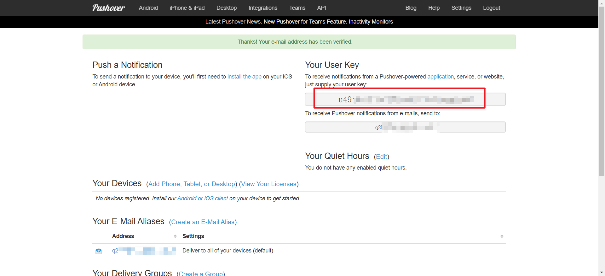
3. 网页向下滑动，点击创建app
   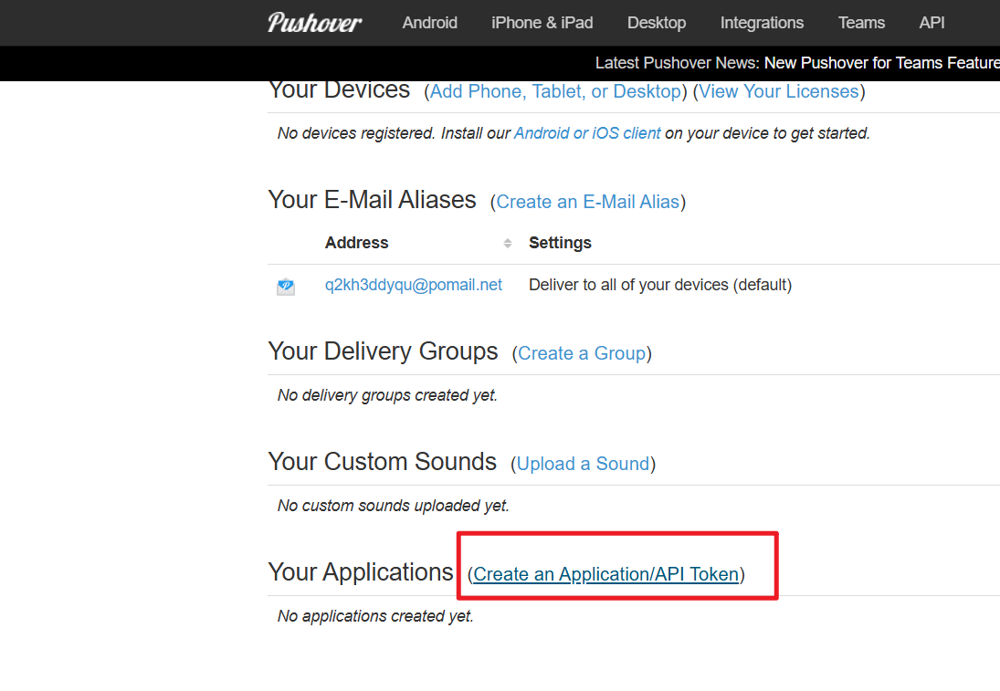
4. 输入一个app名称，如nb2，勾选条款后点击创建
   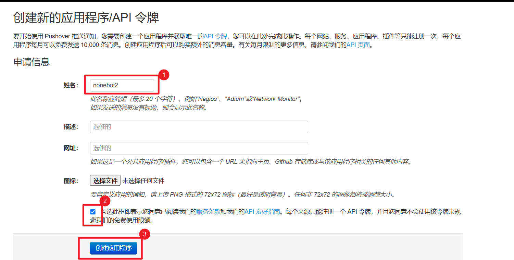
5. 复制此处token
   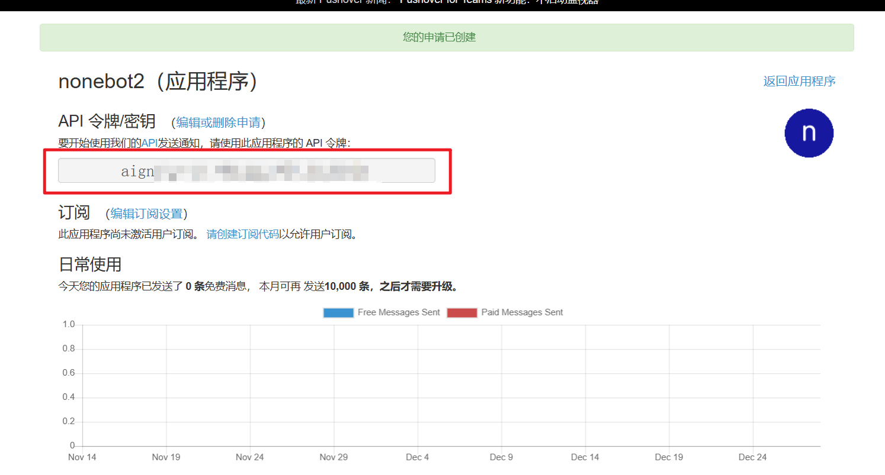

6. 将user_key和token按照下方配置项名 disconnect_notice_pushover_user_key = "",disconnect_notice_pushover_token = "" 填入
   `.env.prod` 文件内

7. 打开[pushover客户端下载页](https://pushover.net/clients)下载至少一个设备端的应用并登录相同账号
    - ```注意```:ios端及mac端可以不用开启app的情况下进行消息推送，安卓端则需要保持google在线或app后台运行状态，这点对于安卓端相当不友好
    - ```注意```:每个设备端至多有30天试用期，到期后需要花费5美元买断(各设备端单独收费)

</details>

<details>
<summary>飞书webhook 消息配置教程</summary>

1. 建议直接参考[飞书官网教程](https://open.feishu.cn/document/client-docs/bot-v3/add-custom-bot)注册机器人
2. 将得到的地址按照下方配置项名 disconnect_notice_feishu_webhook_url = "" 填入
   `.env.prod` 文件内
3. 安全配置可选 自定义关键词、IP 白名单 和 签名 三种方式的校验，若选择了 `签名校验`，则还需要将配置项名
   disconnect_notice_feishu_secret = "" 填入`.env.prod` 文件内
4. 之后bot就可以发送通知消息

</details>

<details>
<summary>邮件通知配置教程</summary>

- 以qq邮箱为例，其他邮箱的开启smtp方式是类似的

1. 点击qq邮箱的设置
   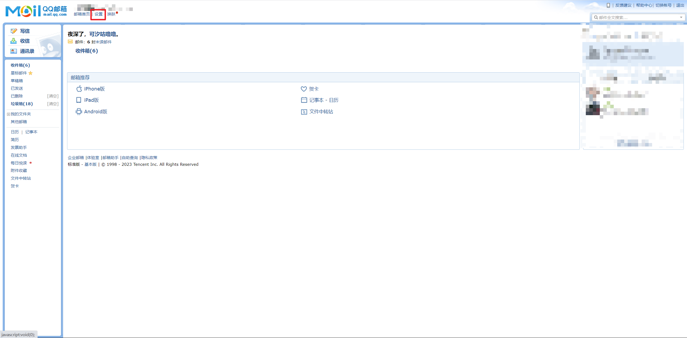

2. 点击账户
   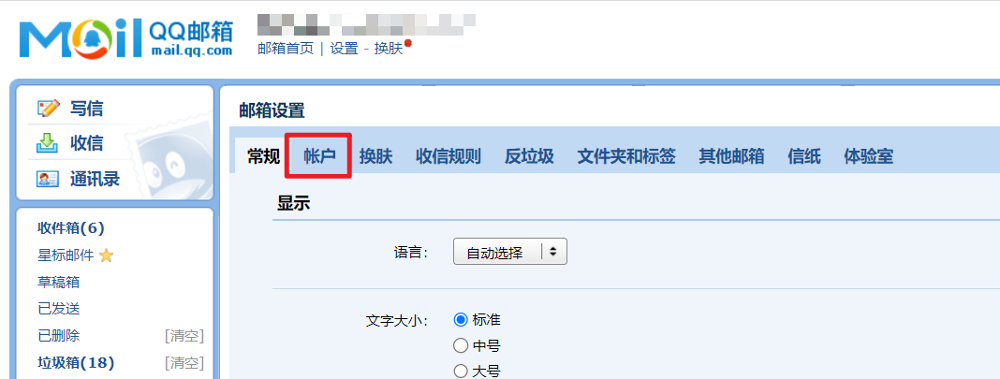

3. 点击管理服务，如果没有开启，这里可能显示的是`开启服务`
   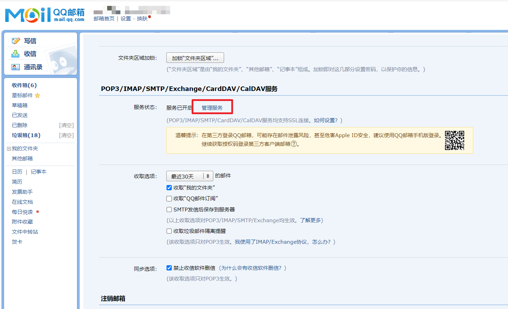

4. 点击`生成授权码`
   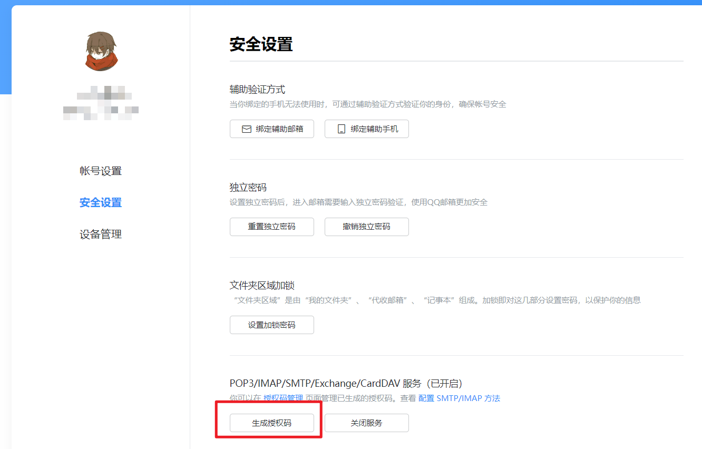

5. 按照要求用密保手机号发送短信验证
   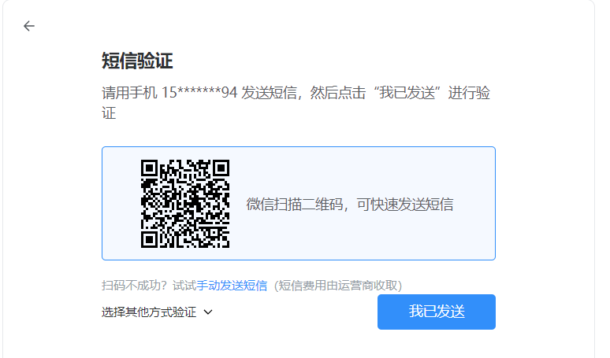

6. 复制得到的这个授权码
   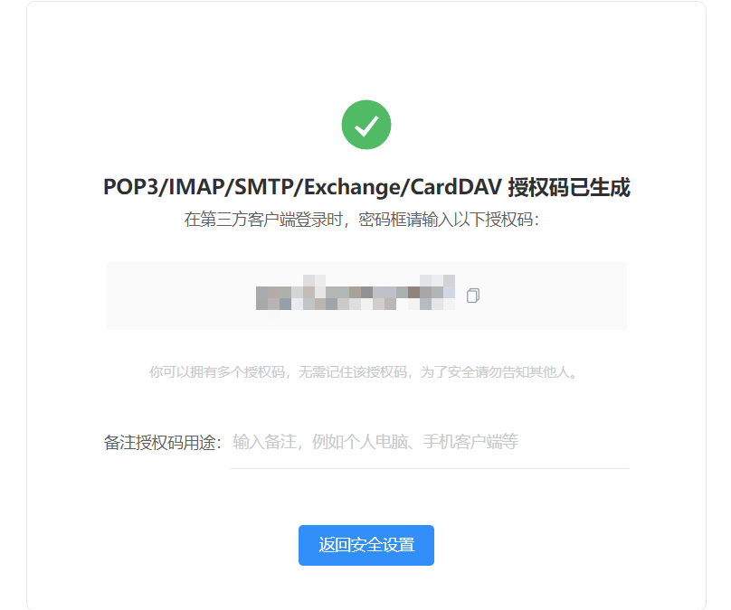

7. 得到的这个`授权码`就相当于邮箱密码，邮箱账号就是qq邮箱，其他的一些常见邮箱的smtp_server和smtp_port配置参数参考下表

|   邮箱名    |   smtp_server   | smtp_port |   
|:--------:|:---------------:|:---------:|
|   qq邮箱   |   smtp.qq.com   |    465    |   
| 网易yeah邮箱 |  smtp.yeah.net  |    465    |
|  阿里云邮箱   | smtp.aliyun.com |    465    |
| 网易163邮箱  |  smtp.163.com   |    465    |
| 移动139邮箱  |  smtp.139.com   |    465    |

</details>

|                 配置项                  | 必填 |    值类型    |    默认值     |                                      说明                                       |
|:------------------------------------:|:--:|:---------:|:----------:|:-----------------------------------------------------------------------------:|
|     disconnect_notice_mode_list      | 是  | list[str] | ["server"] | 通知类型列表，枚举值: mail server server3 pushplus pushover，可填写多个通知源，如["server"，"mail"] |
|   disconnect_notice_pushplus_token   | 是  |    str    |     ""     |                        pushplus微信公众号token，具体获取方式见上方教程                         |
|     disconnect_notice_server_key     | 是  |    str    |     ""     |                       server酱Turbo微信公众号key，具体获取方式见上方教程                        |
|    disconnect_notice_server3_key     | 是  |    str    |     ""     |                            server酱3key，具体获取方式见上方教程                            |
| disconnect_notice_pushover_user_key  | 是  |    str    |     ""     |                         pushover user_key，具体获取方式见上方教程                         |
|   disconnect_notice_pushover_token   | 是  |    str    |     ""     |                          pushover token，具体获取方式见上方教程                           |
| disconnect_notice_feishu_webhook_url | 是  |    str    |     ""     |                    飞书 web_hook地址，需要添加https://头，具体获取方式见上方教程                    |
|   disconnect_notice_feishu_secret    | 否  |    str    |     ""     |                    飞书 签名密钥，只有在选择了签名校验时才需要填写这个值，具体获取方式见上方教程                    |
|     disconnect_notice_smtp_user      | 是  |    str    |     ""     |                            邮箱账号,如 114514@yeah.net                             |
|   disconnect_notice_smtp_password    | 是  |    str    |     ""     |                               邮箱密码或授权码,如 114514                               |
|    disconnect_notice_smtp_server     | 是  |    str    |     ""     |                            邮箱服务器地址,如 smtp.yeah.net                            |
|     disconnect_notice_smtp_port      | 是  |    int    |    465     |                               邮箱端口号，ssl模式时为465                                |
|    disconnect_notice_notice_email    | 是  |    str    |     ""     |                                收件人邮箱，填写自己邮箱即可                                 |
|      disconnect_notice_dev_mode      | 否  |   bool    |   False    |               开发者模式，该模式下bot断开连接不会触发通知消息，避免本地测试插件时不断重载而导致的大量掉线通知               |
|   disconnect_notice_max_grace_time   | 否  |    int    |     10     |                    断连后最大宽限时长，单位:秒，如果在此期间bot完成了重连，则不触发邮件通知                     |

<details>
<summary>示例配置</summary>

```env
## disconnect_notice掉线通知示例配置
# 通知方式list，可填写多种通知方式 枚举值:pushplus mail server
disconnect_notice_mode_list = ["pushplus"]
# pushplus微信公众号通知 https://www.pushplus.plus/
disconnect_notice_pushplus_token = ""
# server酱Turbo https://sct.ftqq.com/r/1483
disconnect_notice_server_key = ""
# server酱3 https://sc3.ft07.com/
disconnect_notice_server3_key = ""
# pushover
disconnect_notice_pushover_user_key = ""
disconnect_notice_pushover_token = ""
# feishu
disconnect_notice_feishu_webhook_url = ""
disconnect_notice_feishu_secret = ""
# 邮件通知
disconnect_notice_smtp_user = "114514@yeah.net" #邮箱账号
disconnect_notice_smtp_password = "114514" #邮箱密码
disconnect_notice_smtp_server = "smtp.yeah.net" #邮箱服务器地址
disconnect_notice_smtp_port = 465 #邮箱端口号
disconnect_notice_notice_email = "114514@qq.com" #收件人邮箱
# 其他设定
disconnect_notice_dev_mode = False #开发者模式，该模式下bot断连不会触发通知消息，避免本地测试插件时不断重载而导致的大量掉线通知
disconnect_notice_max_grace_time = 10 #断连后最大宽限时长，单位:秒，如果在此期间bot完成了重连，则不触发邮件通知
```

</details>

## 🎉 使用

### 指令表

|  指令   | 权限 | 需要@ |  范围  |           说明            |
|:-----:|:--:|:---:|:----:|:-----------------------:|
| /掉线测试 | 主人 |  否  | 所有会话 | 主动触发掉线通知测试，用来测试通知是否正常可用 |

### 效果图

<details>
<summary>邮件通知</summary>

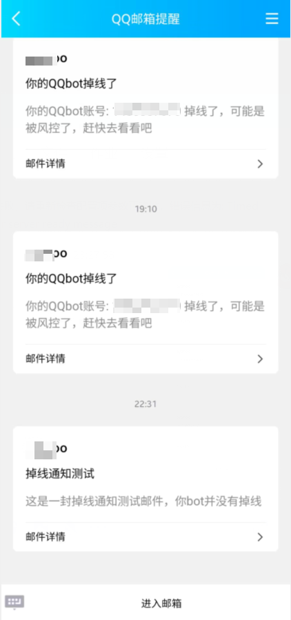

</details>

<details>
<summary>pushplus微信通知</summary>

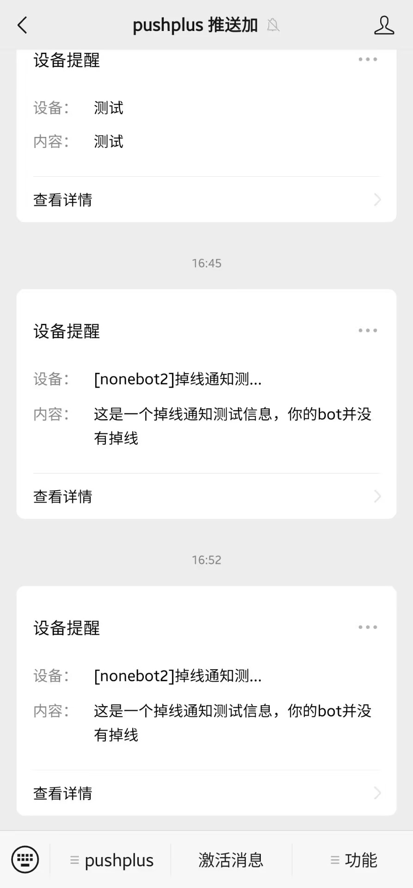

</details>

<details>
<summary>server酱微信通知</summary>

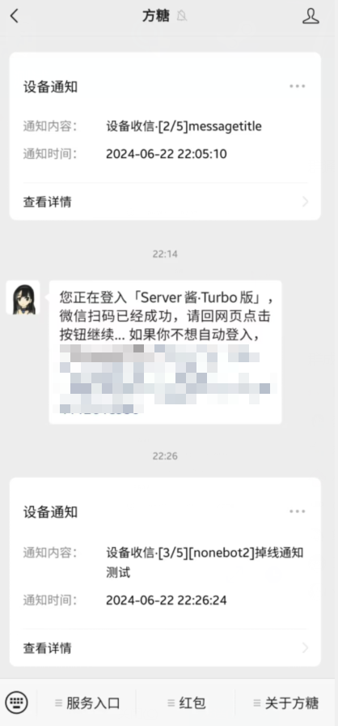

</details>

<details>
<summary>server酱3app通知</summary>

- 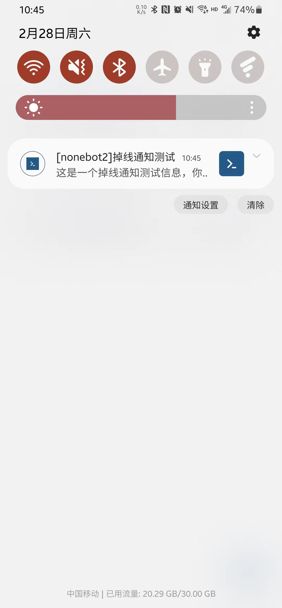
- 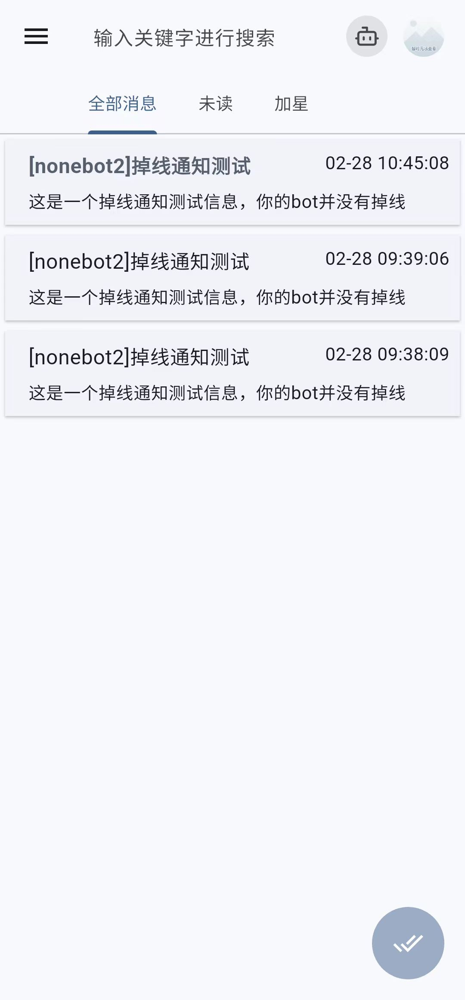

</details>

<details>
<summary>pushover通知</summary>

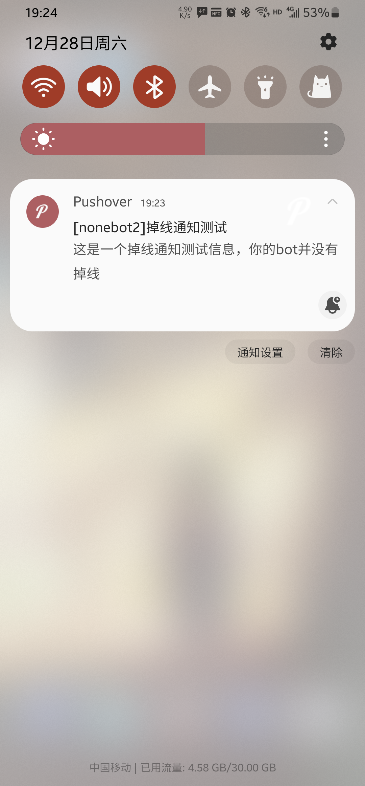
</details>

<details>
<summary>飞书通知</summary>

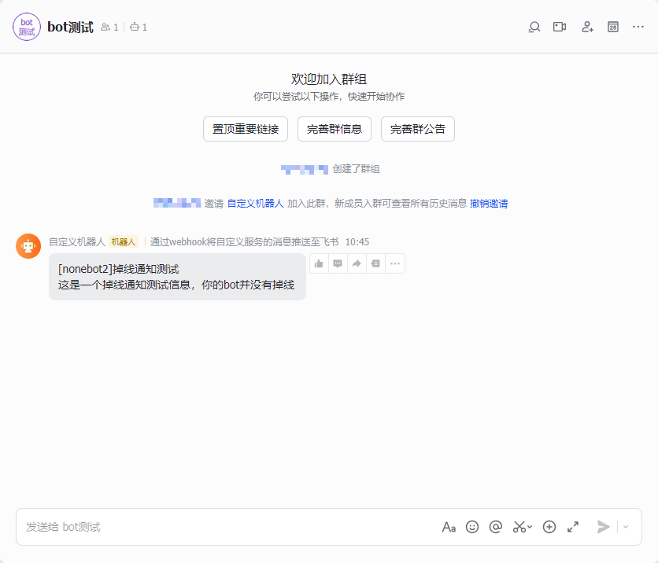
</details>

## ✨喜欢的话就点个star✨吧，球球了QAQ

## ⏳ Star 趋势

[](https://starchart.cc/Cypas/nonebot_plugin_disconnect_notice)
